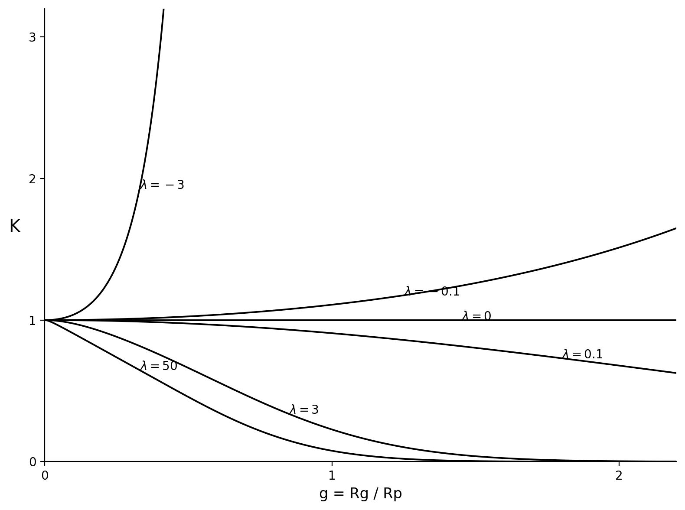

# Homopolymer Graph

October 15, 2026 Entry

Today, I completed my first homopolymer graph using Python and a Jupyter notebook. This graph shows how the partition coefficient $K$ changes as the polymer size becomes larger relative to the pore size.

**What the graph represents**

In the model, $g=R_G/R_P$ compares the polymer size, $R_G$, with the pore size, $R_P$. The vertical axis is the partition coefficient $K$, which describes how the polymer distributes between inside and outside the pore.

The graph uses interaction parameters $\lambda=50$, $3$, $0.1$, $0$, $-0.1$, and $-3$. Positive values represent repulsion between the polymer units and the pore wall, while negative values represent attraction.

**What I coded**

I named the main calculation function `K_homopolymer`. It calculates the partition coefficient by adding terms in the homopolymer equation. Each term depends on an odd mode $m$ and a characteristic value $\alpha_m$.

The code first defines a numerical root-finding function. Then it calculates $\alpha_m^2$ for each mode. Finally, it adds the terms over 101 odd modes to estimate $K$ for every value of $g$.

The main parts of the work were:

1. Translating the homopolymer equation into Python.
2. Solving the characteristic equation numerically.
3. Calculating $K$ for 501 values of $g$ between 0 and 2.2.
4. Plotting one curve for each value of $\lambda$.
5. Labeling each curve with its actual $\lambda$ value instead of arbitrary numbers.
6. Saving the graph as a PNG and adding it to the notebook output.

I also compared the equation in the notebook with a separate Python script. This helped me understand that the notebook and script should use the same function names and calculations.

**What I learned**

The positive-$\lambda$ curves generally decrease as $g$ increases. This means the polymer becomes less likely to enter the pore as it becomes larger compared with the pore. The negative-$\lambda$ curves increase because attractive interactions pull the polymer toward the pore wall. At $\lambda=0$, the model gives $K=1$, so the polymer does not gain or lose partitioning from the wall interaction.

This was important because it connected the mathematical equation to a visible research result. I can now change the $\lambda$ values, run the notebook, and investigate how the curves respond instead of only solving the equation by hand.
