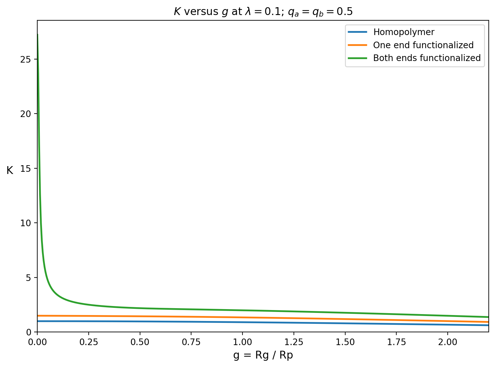
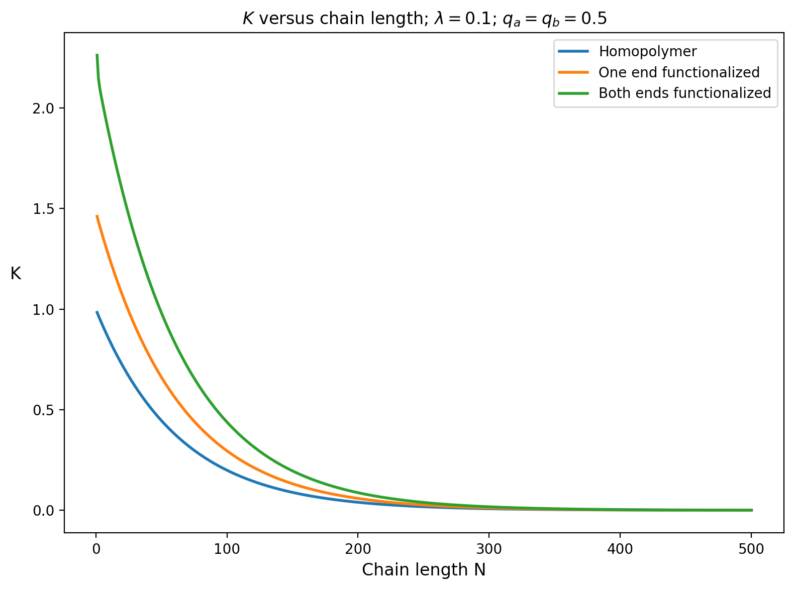

November 1, 2026 Entry

Today, I expanded my research code from an ordinary homopolymer to linear polymers with functional end groups. I developed separate calculations for polymers with one functional end and polymers with functional groups at both ends.

**Why functional ends matter**

A functional end is different from the repeating units along the polymer chain. Its adsorption behavior can be stronger or weaker than that of the ordinary polymer units. This means a polymer's total partition coefficient may depend on both the chain itself and the chemical groups attached to the ends.

For this project, I used equations (3) and (4), along with equations (9) and (10), from the supplied Gorbunov paper.

**Singly functionalized polymer**

For a polymer with one functional end, the paper gives

\[
K^{(1)}=K^{(0)}+q_ap_a.
\]

Here, \(K^{(0)}\) is the ordinary homopolymer partition coefficient, \(q_a\) controls the additional interaction strength of the functional end, and \(p_a\) is the probability that the end contacts the pore wall.

The first new function I wrote was `U1`, which calculates \(p_a\). It uses equation (9):

\[
p_a=U_1(\lambda,g)=\sum_{k\text{ odd}}\frac{2\lambda}{\lambda+\lambda^2+\alpha_k^2}e^{-\alpha_k^2g^2}.
\]

**Doubly functionalized polymer**

For a polymer with functional groups at both ends, equation (4) is

\[
K^{(2)}=K^{(0)}+q_ap_a+q_bp_b+q_aq_bp_{ab}.
\]

This includes separate corrections for both ends plus a cross term that accounts for simultaneous or combined end-wall interactions.

I wrote `U2` to calculate the two-end contact probability from equation (10):

\[
p_{ab}=U_2(\lambda,g)=\sum_{k\text{ odd}}\frac{2\alpha_k^2}{\lambda+\lambda^2+\alpha_k^2}e^{-\alpha_k^2g^2}.
\]

**Two ways of plotting the results**

The first plot compares the three cases at different values of \(g=R_G/R_P\):

- an ordinary homopolymer;
- a polymer with one functional end; and
- a polymer with functional groups at both ends.

The second plot changes the horizontal axis to chain length \(N\). The conversion used the ideal-chain relationship

\[
g=\frac{b}{R_P}\sqrt{\frac{N}{6}},
\]

where \(b/R_P\) controls the connection between chain length and pore-size ratio. The plot examines how added functional ends change \(K\) as the chain becomes longer.

**Parameters used in this version**

The demonstration plot uses \(\lambda=0.1\), \(q_a=0.5\), and \(q_b=0.5\). These are adjustable research parameters. The \(q\) values control the strength of the additional end-group interactions, not the interaction of the ordinary repeating units.

I checked that setting \(q_a=q_b=0\) reproduces the ordinary `K_homopolymer` result exactly. This confirms that the new equations reduce to the original homopolymer model when both functional-end corrections are removed.

**What I learned**

The one-end correction depends on a one-end contact probability, while the two-end correction also contains the product \(q_aq_b\) and the two-end probability \(p_{ab}\). This means adding a second functional end does more than simply add the first correction twice. The cross term describes how both ends can contribute together.

The \(K\) versus \(g\) graph shows how functional-end effects change as polymer size approaches or exceeds pore size. The \(K\) versus chain-length graph gives a more direct way to investigate how end groups become more or less important as \(N\) increases.

These calculations give me a starting point for comparing functional-end strength, pore size, chain length, and ordinary homopolymer behavior in more realistic research cases.
